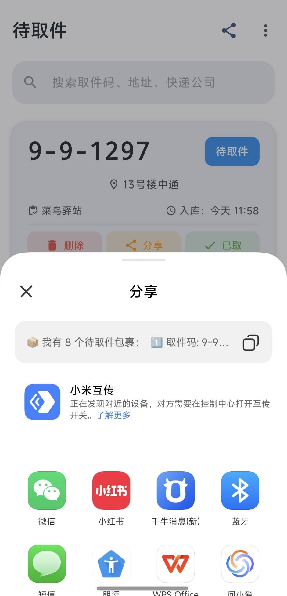
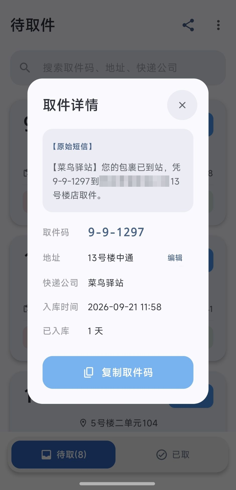
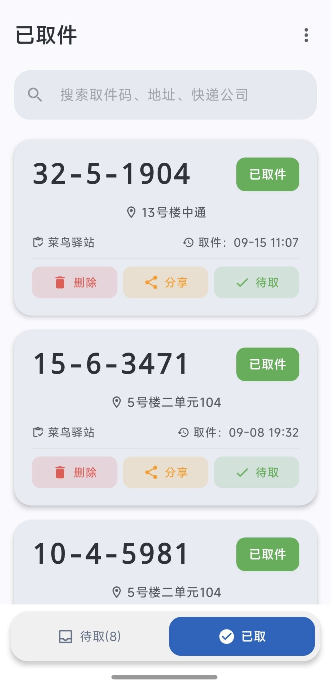
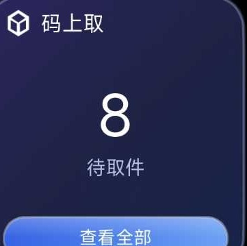
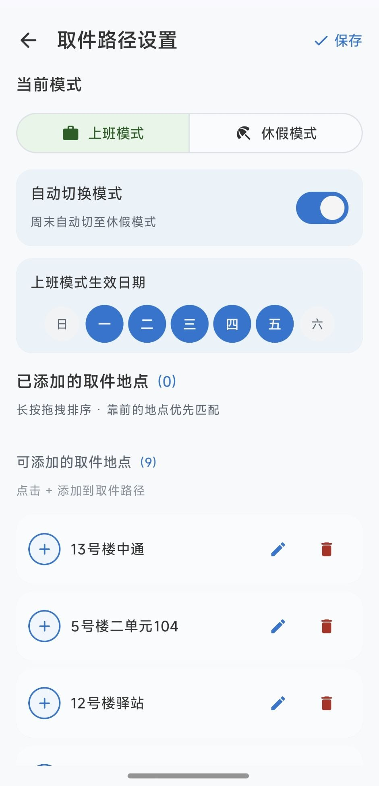

# 码上取 · PickupManager

> ## 代码来源与定制声明
>
> **原始作者：[shanqiugzs](https://github.com/shanqiugzs)** ｜ 上游项目：<https://github.com/shanqiugzs/PickupManager>
>
> 本仓库是 **hcliu987 的个人定制版**，基于上述上游项目修改而来。原始代码的版权归 shanqiugzs 所有，整体沿用 **GPLv3** 许可（见 [LICENSE](LICENSE)）；以下定制改动与提交历史可逐条核对。
>
> **主要定制**：快递公司只显示真实承运方（不再显示兔喜生活等驿站品牌）· 京东等短信地址解析修正 · 规则匹配页与自动入库口径统一 · 快递名称放大高亮 · 7 天记录保留与手动清理 · 一加 PHM110 真机验证。

> **当前版本：v1.2（versionCode 3）更新内容**
>
> - 启动时自动检查更新，发现新版弹窗提示
> - 菜单 / 关于页检查更新，一步下载最新 APK
> - 已取页面一键删除（红色按钮 + 二次确认）
> - 7 天记录保留与手动清理
> - 快递公司只显示真实承运方
> - 一加 PHM110 真机验证
>
> 最新 APK 永久直链：<https://gitee.com/884024720/pickup-manager/releases/download/latest/pickupmanager.apk>（随发版脚本自动重建，始终指向最新版）；更新内容的机器可读源是根目录 `version.json`。

**「码上取」——让取件回归简单**

一个**本地优先**的安卓快递取件助手：自动读取取件短信，解析出取件码、**真实快递公司**与地址，显示在桌面小部件上。

无服务器、无账号、无广告、无统计 SDK。取件数据全部留在本地；应用声明 `INTERNET` 权限**仅用于启动时检查新版本**（向 Gitee 公开 API 发一次 GET 读取 `version.json`），**不上传任何取件内容、设备标识或个人信息**。可自行抓包或在 `AndroidManifest.xml`、`UpdateChecker.kt` 中逐行核对。

本文档是主说明文档，每条已知问题的定位证据与审计记录在 `docs/`。只想用：读第 1、2、4 节。想改代码：读第 3、5、9 节。

**目录**：1 它做什么 · 2 未完成与实验性功能 · 3 已知问题清单 · 4 隐私 · 5 架构 · 6 构建与发布 · 7 准确率怎么量 · 8 第三方许可 · 9 参与贡献 · 10 许可条款 · 11 商标与免责

---

## 1、它做什么

Android 7.0+（`minSdk 24`）。release 包约 2.8 MB，无原生库、无后端。

| 能力 | 说明 |
|---|---|
| 自动接收 | 监听 `SMS_RECEIVED`，命中快递短信即解析入库（更新列表、小部件与通知栏汇总；不做逐条提醒、不做过期提醒） |
| 批量导入 | 首次启动可一次性导入收件箱里已有的取件短信 |
| 解析引擎 | 规则引擎为主（引导词优先 → 快递签名/码形映射），未命中回落兜底解析器 |
| 快递公司 | 卡片只显示**真实承运快递公司**（中通 / 圆通 / 极兔 / 申通 / 顺丰 / 京东 / 中国邮政 / 韵达 / 德邦 / 百世），不会把【兔喜生活】【妈妈驿站】【邮乐购】这类代收点签名当成公司；规则匹配页与自动入库共用同一套规范器 |
| 取件列表 | 待取件 / 已取件两栏，搜索、复制取件码、一键标记已取；列表只加载显示字段、短信原文点开详情时按需读取 |
| 地址库 | 记住你纠正过的地址。**地址覆盖表三条采集路径都生效；"常用驿站归一"在广播与批量导入路径生效，通知兜底路径未接入**（见 #6） |
| 规则匹配界面 | 粘贴短信预览解析、手动录入条目、纠正地址可用；**「学习规则」不生效**（见第 2 节） |
| 取件路线 | 多个驿站组织成路线，按顺路程度排序 |
| 桌面小部件 | 7 种尺寸（2×2 / 3×3 / 3×4 / 4×3 / 4×4 / 5×3 / 5×4），一键已取与刷新 |
| 通知栏汇总 | 下拉栏常驻一条「待取 N 件」，随入库 / 已取自动更新，点开进应用；默认只显示数量，设置里可整条关闭或选择显示最新取件码，**地址在任何情况下都不进通知** |
| 品牌适配 | 识别 MIUI/HyperOS 等，按其差异引导"通知类短信"、电池优化、自启动权限 |
| 自动清理 | 入库满 **7 天**的记录由 WorkManager 每天兜底删除（含待取）；也可在设置里「清理 7 天前的记录」手动提前删。已删留档保留 30 天防短信复活 |
| 应用内更新 | 启动后台检查一次 `version.json`，发现更高 `versionCode` 弹窗提示（立即下载 / 稍后 / 不再提示此版本）；列表菜单与关于页也可手动检查并一步打开最新 APK 直链。网络失败静默，不影响正常使用（详见第 6 节） |
| 机型覆盖 | 已在**一加 PHM110（Android 15）**做真机验证（6 条真实短信解析、卡片显示、DB 落库）；历史版本在小米 / HyperOS 上验证过。其它品牌未做真机验证，问题请附机型与系统版本 |

### 界面

| 待取件 | 取件详情 | 已取件 |
|:---:|:---:|:---:|
|  |  |  |

| 桌面小部件（2×2，另有 6 种尺寸） | 取件路径设置 |
|:---:|:---:|
|  |  |

截图取自作者手机，小区名已打码。

---

## 2、未完成与实验性功能

判断标准：**你按了按钮、它给了反馈，而系统行为其实没变** —— 这种才叫坑。

- **「学习模式」与自定义规则不生效。** 保存时写入的是一个内存 List（进程重启即清空），而生产在用的解析器从不读它。界面上的"学习成功 / 置信度 90%"只描述当前这条短信的判断，不是"系统记住了一条规则"。该功能属**实验性、开发到一半**：入口与规则表都在，缺持久化与与内置模板的优先级处理。
- **目前唯一真正能改善解析结果的操作是「纠正地址」**，它持久化到 SharedPreferences 并每次解析查表，重启不丢。取件码本身识别错，暂时无法通过界面修复。
- **规则匹配页的「快递公司」与自动入库同口径**：粘贴短信后显示真实承运方（不是驿站签名），手动改正后保存会记一条纠错样本供自学习评分；但这条样本**不改变解析器的实际取码/取地址行为**（仍属上面的实验性范畴）。
- 想让某类短信被正确解析，请在 Issue 里附**脱敏后的短信格式**（码、楼栋、电话换成假值，保留结构与引导词）。
- **`notes`（备注）**：列、管道都有，没有任何界面能输入，永远是空串。
- **`phoneNumber`**：只有兜底解析器会填，主解析路径不填，界面也不展示。
- **当前版本不含本地 ONNX 模型推理层与应用内提醒通知**。前者属**暂缓而非废弃**：它与正则匹配的成绩没有明显差距，缺少可信的留出集数据支持其更优，且模型资产约 20 MB、推理开销更大，收益与代价不成比例；若后续有数据证明其优于现行正则方案，会重新评估并打包。后者（新取件提醒与过期提醒）已整套删除，决定不做。2026-11-09 起新增的「通知栏汇总」是另一回事：一条不响铃、不提醒、不做过期的常驻数量卡片，见第 1 节与 `util/PickupSummaryNotifier.kt`。
- **无多语言**：界面中文硬编码在 Kotlin 里（约 **1539 处**含中文的字符串字面量；口径为先剔注释再统计双引号字面量，由 `tools/check_doc_refs.py` 复算），`values-en` 不存在。

每条实验性功能的代码定位见 [`docs/KNOWN_ISSUES.md`](docs/KNOWN_ISSUES.md) 第一节。

---

## 3、已知问题清单与修复状态

按"修好它带来的价值"排序。文中所有 `文件:行号` 与符号引用由 `tools/check_doc_refs.py` 机械校验；仓库内含 `.github/workflows/android.yml` 自动审计配置（需具备 `workflow` 权限的 token 推送）。

| # | 问题 | 状态 |
|---|---|---|
| 1 | 通知监听通道解析成功却不入库 | ✅ 已修（三条通道统一走 `PickupIngest`） |
| 2 | 规则自学习不生效 | 🧪 实验性、开发到一半，已如实标注 |
| 3 | 本地 ONNX 模型推理层 | ⏸ 暂缓：当前版本未包含；有留出集证据证明更优时重新接入 |
| 4 | 过期记录从界面凭空消失 | ✅ 已修（含历史数据回补） |
| 5 | 应用内通知整条链路无人触发 | ✅ 整套删除 |
| 6 | 采集入口有多套实现（解析、归一、标签不一致） | ✅ 已修：三条通道统一经 `util/PickupIngest.kt` |
| 7 | Room schema 不可校验 | ✅ 已修（schema 8/9/10 已导出；迁移测试仍缺，见 #26） |
| 8 | 无多语言 | ⛔ 不在本仓库规划内 |
| 9 | 测试覆盖错位 | ✅ 已修（123 用例 + 度量工具；兜底解析器补 14 个契约用例） |
| 10 | 日志泄漏隐私 | ✅ 已修（含 5 处 `Log.w/e` 漏点），并加了 CI 门 `tools/check_log_privacy.py` |
| 11 | 隐式广播外发取件码与住址 | ✅ 已修（限定包名） |
| 12 | `WidgetRefreshActivity` 孤儿 Activity | ✅ 已删 |
| 13 | 三个漏删的死文件（379 行） | ✅ 已删 |
| 14 | `deleted_pickup_items` 只增不减，且每行存完整原文 | ✅ 已修（老用户历史行未回填） |
| 15 | `<application>` 缺 `android:name`，整个 Application 从未生效 | ✅ 已修；连带的多进程重复初始化也已加主进程门控（见 #15 明细，已过编译与单测，真机行为待复核） |
| 16 | 跨进程刷新两套并存，其中一套泄漏 observer | 🔶 泄漏已修，冗余未动 |
| 17 | 半截字段 `notes` / `phoneNumber` | ⏳ 未修 |
| 18 | ViewModel 里一整层没人用的筛选实现 | ✅ 已修（零引用的筛选/排序/菜单状态整层删除） |
| 19 | 隐私章节曾错称"不保存短信原文" | ✅ 已改正 |
| 20 | 小部件声明层与布局层的复制粘贴债 | ⏳ 未修（功能正常，维护成本高） |
| 21 | 应用内没有「一键清空全部数据」入口 | ✅ 已修（设置页二次确认；3 张表 + 7 个偏好文件全清，编译与单测通过，真机行为待复核） |
| 22 | 下拉刷新会重新扫描短信收件箱 | ✅ 已修（改为本地重读；补导走菜单「导入短信」，语义由项目所有者 2026-11-09 确认） |
| 23 | `WidgetActionService` 导出且无权限保护 | 🔶 已加归属校验，路由待真机验证 |
| 24 | `MIGRATION_7_8` 的 DELETE 不可逆，且与"同码多包裹"语义冲突 | ⏳ 未修（应新增迁移，不回改） |
| 25 | `AddressMatcher` 命中缓存时返回短标签（会让地址库逐次退化） | ✅ 已修（历史数据不自愈） |
| 26 | 迁移测试缺失 | ⏳ 未修（最该先补 9→10 与 8→9，这两条会改写数据） |
| 27 | 两项发布前需作者确认的外部事实 | ✅ 已确认（图标作者自制；提交与源码署名统一为 `shanqiugzs`） |
| 28 | `AnimationConfig` 保留着无人引用的成员 | ✅ 已修（收缩到 2 个实际被读字段 + `Standard` 单一预设；编译与单测通过，动效观感待真机复核） |
| 29 | 真实取件码与地址片段写在源码注释里 | ✅ 已删（公开版本的历史里也不存在） |
| 30 | 泄露核查跑不进 CI | 🔶 形状判据已进 CI；精确值判据需私有语料，只能在本机跑 |
| 31 | 合并后的 APK 比手写清单多四项权限（含删过又被 `androidx.work` 加回来的 `WAKE_LOCK`） | 🔶 已逐项披露并标注引入方，未移除（行为变更需真机验证） |
| 32 | 权限向导曾把"通知"设成必须，并用它挡住导入 | ✅ 已修（连带修掉"导入短信"在部分机型恒不可用） |
| 33 | 小部件接收器导出，`MARK_PICKED` 接受可枚举的数据库 id | 🔶 已收窄，未根治（需真机） |
| 34 | 一类"作者自述"的数字仓库内无法证伪 | ⚠️ 已单独标注口径，见 `docs/audit/99-unverifiable.md` |

**故意不修（权衡而非遗漏）**：#8、#20，以及 Gradle `distributionSha256Sum` 钉哈希（本机算不出可信值，钉错会让所有人的构建失败）。

**后续计划**（按可落地程度排序）：① 通知兜底路径接入地址归一（#6 剩余部分）；② 补迁移测试（先 9→10 与 8→9，schema 已导出，需 instrumented test）；③ 跨进程刷新统一到 Room 失效通知（需真机验证时序）；④ 小部件接收器授权加固（彻底方案需真机）；⑤ `notes` / `phoneNumber` 二选一（填全并展示，或随 Room 迁移一起删，见 #17）。

2026-11-09 已完成的一批：#15 多进程门控、#9 兜底解析器单测、#18 死代码、#21 一键清空、#22 刷新语义、#28 动画配置收缩。

每条问题的完整说明、定位证据与修复依据见 [`docs/KNOWN_ISSUES.md`](docs/KNOWN_ISSUES.md) 第二节；`docs/audit/` 下另有更细的缺陷台账与审计依据。

---

## 4、隐私

- **唯一的网络行为是检查更新**：`UpdateChecker.kt` 用 JDK 自带的 `HttpURLConnection` 在启动时 GET 一次 Gitee 公开 API 的 `version.json`，对比版本号，仅此而已；网络失败静默忽略。**不上传取件数据、不传设备标识、不传位置**，没有 `OkHttp` / `Retrofit` / 统计 SDK / 加载远程网页的 `WebView`。可在 `UpdateChecker.kt` 中逐行核对请求 URL 与字段。
- 但合并后的 APK **比手写清单多三项权限**：`ACCESS_NETWORK_STATE`、`RECEIVE_BOOT_COMPLETED`、`WAKE_LOCK`，全部由 `androidx.work` 传递引入（`aapt dump permissions` 可核）。这三项都不是发包能力：前两项一个只判断"有没有网"、一个用于开机恢复排期，第三项是 WorkManager 自己的声明 —— **本应用手写清单里删掉过它，它又被库加回来了**。要彻底剥掉需 `tools:node="remove"` + 真机验证（见 #31）。
- 核对方式：`aapt dump permissions app-release-unsigned.apk` 读出 10 项系统权限 + 1 项应用私有权限。手写清单里那 7 项的用途（含两条被删掉的受限权限及删除理由）写在 `app/src/main/AndroidManifest.xml` 的注释里，合并清单的逐项对表见 `docs/KNOWN_ISSUES.md` 问题 31。
- **无统计 / 广告 / 崩溃上报 SDK**，依赖全部来自 Google 与 Maven Central 官方坐标。
- **数据只落在本地，且有保留期**：Room 库 `pickup_manager.db` 中入库满 **7 天**的记录（含待取）会被 WorkManager 每天兜底删除，也可在设置页手动提前清理；已删留档保留 30 天防止旧短信复活。外加 7 个 SharedPreferences 文件（`address_overrides` 地址覆盖表、`widget_data_cache` 小部件快照、`self_learning_prefs` 纠错历史、`permission_cache` 与 `permission_prefs` 权限缓存、`sms_permission_tracker` 短信权限状态、`pickup_manager_prefs` 通用偏好与导入标记）。系统设置里「清除数据」或卸载可彻底清除；**应用内设置页也提供带二次确认的「清空全部数据」**（见 #21），一次清掉三张表与上述 7 个偏好文件，并保留导入闸门以免短信被自动重新导入。
- **短信原文会入库**（详情页展示与复制用）。导入时按 `content://sms` 全表游标读取，每条正文都会进内存一次，判定不是取件短信随即丢弃 —— "只读快递短信"这种说法做不到，本文不写。
- 数据离开本应用有两条通道，均由用户主动触发：**剪贴板复制**，以及**分享到其它应用**（`Intent.ACTION_SEND`，把取件码 + 地址 + 快递公司交给用户选定的目标应用）。此外更新检查会向外发一个不含任何取件数据、只有固定 URL 的 GET 请求；分享之后第三方如何使用不在本应用控制范围内。
- 存 `senderPhone`（发件号码）与 `phoneNumber`（正文中的快递员电话）；**不存**设备标识符（无 IMEI / Android ID / 广告标识）与位置信息。
- debug 包不做日志剥离，**发布请只用 `assembleRelease`**。

---

## 5、架构说明

单模块 Android 应用（`:app`），无后端。Kotlin + Jetpack Compose + Room + AppWidget。

```
短信 / 通知
   ├─ receiver/SmsReceiver             SMS_RECEIVED 广播
   └─ sms/PickupNotificationListener   通知监听（备用通道）
                 │
                 ▼
       util/PickupIngest（唯一入口：解析 + 取件码归一 + 地址标签）
                 │
                 ▼
       data/repository/PickupRepository ←→ Room（三张表）
                 ├─ ui/      Compose 界面（主进程）
                 ├─ widget/  桌面小部件（RemoteViews）
                 └─ worker/  WorkManager 周期任务
```

| 包 | 文件数 | 职责 |
|---|---|---|
| `receiver/` | 2 | 短信广播入口、应用退出广播 |
| `sms/` | 1 | `NotificationListenerService` 备用采集通道 |
| `util/` | 25 | **解析引擎所在地**，另含权限、通知渠道、品牌检测 |
| `service/` | 1 | `AddressMatcher`：相似度匹配 + 地址标准化 |
| `data/` | 11 | Room 数据库、DAO、实体、Repository、跨进程通知 |
| `ui/` | 23 | Compose Activity、3 个屏幕、12 个组件与对话框、ViewModel、主题、动画 |
| `widget/` | 15 | 7 个 Provider + 基类 + 列表服务 + 前台刷新服务 + 品牌适配 + 快照 |
| `worker/` | 1 | 过期检查与历史记录清理 |

根包另有 `PickupApplication.kt`，主源 `.kt` 共 **80 个文件、22812 行**（文件数同样由 `tools/check_doc_refs.py` 核对）。

- **解析层**：主解析器按五级优先策略取码，**第 0 级是引导词**（短信里明写「取件码为 / 凭 / 输入」就直接取后面那串）；未命中时回落到使用多维加权评分与一票否决规则的 `PickupSmsParserV2`。**它不是模型，是纯规则。** 三条采集通道（广播 / 导入 / 通知）统一经 `util/PickupIngest.kt` 完成解析、取件码归一（`PickupCodeNormalizer`）与地址标签生成（`AddressTag`）。
- **数据层**：Room `version = 10`，三张表（`PickupItem` / `SavedAddress` / `DeletedPickupItem`），`app/schemas/` 导出 8/9/10 供迁移校验。状态常量仍定义着"已过期"，但**现在只有 0 待取 / 1 已取会被写入**，过期改由展示层判断（见 #4）。
- **进程**：最多三个 —— 主进程、`:widgetProvider`（仅 5×3 那一个 Provider 声明）、`:main`（`DataChangeContentProvider`，不是主进程别名）。
- **小部件**：`BasePickupWidgetProvider` 模板方法 + 7 个各 10 行的子类，这层抽象是干净的；重复在 Manifest 的 7 段 `<receiver>` 与 6 份只差 dp/sp 的布局。RemoteViews 与 Compose 并存是平台硬约束，不是迁移残留。

---

## 6、构建与发布

| 组件 | 版本 |
|---|---|
| JDK | 17+ |
| Android SDK Platform | 34（`compileSdk` / `targetSdk`），`minSdk = 24` |
| Gradle / AGP | 8.13（用仓库内 `gradlew`）/ 8.13.2 |
| Kotlin / KSP | 2.0.21 / 2.0.21-1.0.27 |

**不需要 NDK 与 CMake**，无原生代码，克隆后直接构建。

```bash
git clone https://github.com/hcliu987/PickupManager.git
cd PickupManager
echo "sdk.dir=/你的/Android/Sdk" > local.properties   # ANDROID_HOME 已设置可跳过
./gradlew :app:assembleDebug                          # 产物 app/build/outputs/apk/debug/
./gradlew :app:installDebug                           # 直接装到设备
```

发布版：

```bash
export PICKUP_KEYSTORE_PATH=release-key.jks
export PICKUP_KEYSTORE_PASSWORD=... PICKUP_KEY_ALIAS=... PICKUP_KEY_PASSWORD=...
./gradlew :app:assembleRelease
```

签名信息**不写在构建脚本里**，只从这四个环境变量读取。未设置时构建不会失败，只是产出 `app-release-unsigned.apk`（未签名，不能直接安装），clone 仓库的人无需任何密钥即可验证构建。

> **普通用户请勿自行构建**：签名发布版可从 Gitee 永久直链 <https://gitee.com/884024720/pickup-manager/releases/download/latest/pickupmanager.apk> 一步下载（始终指向最新版），历史版本见 [GitHub Releases](https://github.com/hcliu987/PickupManager/releases)。下面四个环境变量是给需要自行打包的开发者准备的。

自签分发请**永久保管**密钥：覆盖安装必须同一签名，换密钥等于所有已安装用户必须卸载重装，而取件记录与地址库都在应用私有数据库里，会随之丢失。

### 应用内更新怎么工作

| 环节 | 实现 |
|---|---|
| 更新源 | 仓库根 `version.json`，字段为 `versionCode` / `versionName` / `changelog` / `apkUrl`；Gitee contents API 公开可读，国内直连 |
| 检查时机 | App 启动时后台一次；列表菜单「检查更新」与关于页按钮可随时手动打开下载页 |
| 判定 | 服务端 `versionCode` 大于本机才提示；点过「不再提示此版本」后该版本不再弹，升级到更高版本会重新提示 |
| 下载 | 弹窗「立即下载」用系统浏览器打开 `apkUrl`（Gitee latest 直链），应用本身不内置下载器、不请求存储权限 |
| 失败处理 | 无网络 / 超时 / API 解析失败一律静默跳过，不影响取件功能 |
| 隐私边界 | 只有一条固定 URL 的 GET 请求，不上传取件码、地址、设备标识；详见第 4 节 |

**发版流程**（维护者）：`python3 tools/release.py --version 1.3 --changelog "..."` 一条命令完成：递增 `versionCode` → 同步 `version.json` → 构建签名 → 重建 Gitee latest Release（固定附件名 `pickupmanager.apk`，避免同名文件累积）→ 提交版本改动 → 推送 GitHub/Gitee → 创建两端 **v1.3 正式 Release** 并上传 APK → 双端下载校验 SHA256。版本号必须递增：Android 拒绝降级安装，且更新检查按 `versionCode` 比较，不递增等于更新功能失效。

`tools/release.py` 的开关：`--dry-run` 只预览，`--skip-upload` 只升版本+打包，`--no-release` 跳过同步与正式 Release。若代码已同步、只需补发 Release，单独运行 `python3 tools/publish_release.py`（`--no-push` 不推代码，`--dry-run` 预览）。该脚本**幂等**：Release 或附件已存在就跳过，不重复创建、不覆盖 latest 直链；令牌从钥匙串读取，不落盘、不打印。GitHub Push / API 走系统代理（可用 `PICKUP_GITHUB_PROXY` 覆盖），上传域名 `uploads.github.com` 必须直连。

测试与检查：

```bash
./gradlew :app:testDebugUnitTest        # 123 个用例，纯 JVM
python3 tools/check_doc_refs.py         # 文档与代码一致性自检（含可复核数字复算）
python3 tools/check_log_privacy.py      # 发布可见日志里不带用户数据
```

另有 2 个环境变量门控的评测用例（未设置时自动跳过，不影响 CI 与他人构建），以及 9 条审计脚本（脱敏扫描、历史扫描、提交身份、图标 import、`.gitignore` 纵深、缺陷总表结构等），它们各自的回归测试共 **51** 个用例，即 `tools/audit/test_*.py` 共 **51** 个用例 —— 这个数字由 `tools/check_doc_refs.py` 复算。逐条命令见 `.github/workflows/android.yml`。

**产物体积**：release **2.90 MB** / debug **19.79 MB**。清理前的基线是 4.68 MB / 25.86 MB（2026-07-29 的产物）。这 1.78 MB 是整轮清理的合计：移除 ONNX 层与 `onnxruntime` 依赖、主源 Kotlin 文件 106→80 个（28877 行 → 22812 行；其间单测从 16 增至 123 个用例）、删除无人引用的资源与备份规则 XML（当前 release 签名包实测 2.83 MB / 2,963,052 字节，见 Releases）。

---

## 7、解析准确率怎么量

主解析器有两层测试：`RuleBasedPickupParserTest`（14 个行为基线用例，虚构短信，随 CI 常跑）与 `RuleBasedPickupParserAccuracyEval`（准确率/误判率度量工具，由 `PICKUP_EVAL_DATASET` / `PICKUP_EVAL_NEGATIVES` 指向本地标注集，**未设置时自动跳过**）。改正则很容易让解析率悄悄退步，没有一把固定的尺子，任何"已改善"的说法都缺乏依据。

当前读数（1156 条正样本 / 2059 条负样本）：

| 指标 | 数值 |
|---|---|
| 识别为取件短信 | 98.6% (1140/1156) |
| 取件码命中 | 100.0% (1133/1133) |
| 多码误报 | 0.1% (1/1133) |
| 地址提取非空 | 98.6% (1117/1133) |
| 地址与标注重叠 | 75.6% (856/1133)　← 最弱一项 |
| 负样本误判为取件 | 0.73% (15/2059) |

**口径**：语料与规则同源，全部是 in-sample，不能当作对外宣传的准确率，也不代表泛化能力 —— 那需要一批从未参与过训练的新标注样本。报告默认只输出聚合数字，逐条样例（含真实短信）需显式设 `PICKUP_EVAL_SHOW_SAMPLES=1`。语料不在仓库中，因此这些数字无法在仓库内复算。

---

## 8、第三方组件与许可

**运行时依赖全部为 Apache-2.0**（AndroidX Core/Appcompat/Room/Lifecycle/Activity/WorkManager、Material Components 1.11.0、Jetpack Compose BOM 2024.02.00、Kotlin 标准库 2.0.21），与 GPLv3 单向兼容，不产生许可冲突。构建工具（AGP / Kotlin / KSP / Gradle）同为 Apache-2.0。

**唯一例外**：JUnit 4 为 **EPL-1.0**，仅在 `testImplementation` 下使用，不参与 APK 链接与分发。不要把它理解成"所有依赖都是 Apache/MIT"。

**模型文件**：本项目不再包含任何机器学习模型。

**关于借鉴**：四处注释提到参考了上游思路，涉及三个上游 —— `PickupCodeExtractorV3.kt:83`（otphelper，**AGPL-3.0**）、`:123` 与 `ShareUtils.kt:18`（SmsForwarder，GPL-3.0）、`:296`（一个未署名的"取件码 APP"）。借的是"清理预处理 / 分步提取 / 用户自定义规则"这些**想法**，本项目没有链接它们，也没有复制其中任何一行。传染性判定看的是"是否复制了受版权保护的表达"，不是注释里有没有"参考"两字；若要绝对确定，做法是把这四个文件与对应上游逐行 diff。

---

## 9、参与贡献

欢迎。这个项目很小，规则也就几条。

**先读**：第 5 节（真实调用链）与第 3 节（已知问题清单 —— 绝大多数有价值的改动都在里头）。

**两条底线**：解析准确率优先于代码优雅（把 200 行拆成 5 个 40 行，若让某类短信解析率下降就是退步）；数据不能丢（任何碰 Room schema / migration / 删除策略的改动，请在 PR 里说明"老用户升级后会发生什么"）。

| 改动类型 | 最低验证要求 |
|---|---|
| 解析规则 / 正则 | 单测通过，并**新增**覆盖该类的用例 |
| Room / migration | 必须提供 migration 测试 |
| 桌面小部件 / 权限相关 | 需要真机验证说明，注明机型与系统版本 |
| 改 README 的行号或符号名 | `tools/check_doc_refs.py` 通过（CI 亦会校验） |
| 纯重构 / 文档 / 依赖升级 | 构建通过即可 |

我们没法要求每个贡献者都有特定品牌手机（已验证范围为小米 / HyperOS 与一加 PHM110 / Android 15），所以权限与小部件的改动可能需要在 Issue 里等一次真机确认，这不是拖延。

**红线**：不引入网络请求、统计 SDK、广告 SDK、崩溃上报 —— 除非先在 PR 里说服大家这值得牺牲核心卖点，且默认关闭。提交与注释请使用**虚构**的短信、驿站名与取件码；不要提交真实短信、手机号、地址、任何 `.jks` / `keystore.properties` / 模型权重。

---

## 10、许可条款

**本项目采用 GNU GPLv3。** 仓库根目录的 `LICENSE` 为官方全文，逐字未改。

版权与许可声明（每个源文件头部也有同样的 SPDX 许可头）：

```
PickupManager - 本地运行的安卓快递取件助手
Copyright (C) 2026 shanqiugzs  <https://github.com/shanqiugzs>
SPDX-License-Identifier: GPL-3.0-or-later
```

> 本程序是自由软件：你可以在 **GNU GPLv3**（或你选择的任何后续版本）条款下再分发它和/或修改它。

选 GPLv3 的意图四句话：① **允许商用** —— 可以拿它做商业产品、可以收费，不必取得作者同意；② **只要你分发**（把程序交给任何人，含装到别人手机上），衍生的那部分必须以同样的 GPLv3 条款完整开源，闭源商用不允许；③ **任何把本项目代码引入的产品，整体都受 GPL 传染**，必须一并开源；④ **思路自由、代码受限** —— 思路、算法、设计不受著作权保护，任何人可自由借鉴，本项目不主张权利，但复制了本项目的代码（哪怕一行），该作品整体即适用 GPLv3。这是刻意设计。

几条边界：**"分发"才触发义务**（本项目不是 AGPL，没有网络服务条款，"改完只自己跑"不触发源码公开）；**署名**由 GPLv3 第 4、5 条实现，衍生作品须保留全部版权与许可声明；**仅通过 Intent 交互的独立 App 不算衍生作品**，把源码复制进你的工程或链接成一体发布才算；GPLv3 含**反 Tivo 化条款**，把本应用预装进 bootloader 锁定、用户无法自行替换程序的设备时需同时提供安装信息。

**参与贡献的许可**：提交即表示你同意你的贡献以 **GNU GPLv3**（或其后版本）许可被使用，与本仓库许可保持一致。

---

## 11、商标与免责

文中出现的"菜鸟驿站""丰巢""圆通""中通""顺丰""京东物流""极兔""韵达""申通""邮政"等名称与标识归各自权利人所有，此处**仅用于说明解析规则的适配对象**，不构成任何合作、授权、赞助或背书关系；小米、华为、OPPO、vivo、三星等厂商同样不存在任何关联关系。应用图标由作者自制。

本软件按"现状"提供，不对解析结果的准确性作任何担保。取件码解析错误可能导致包裹超期、被退回或冒领，请务必以驿站现场核验为准。
